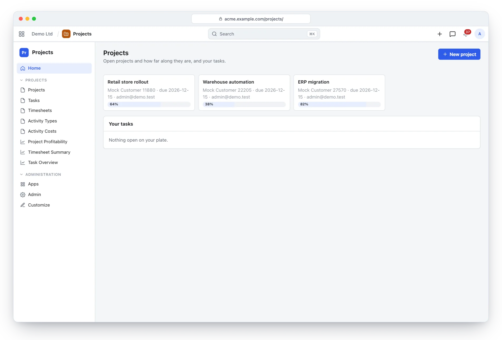
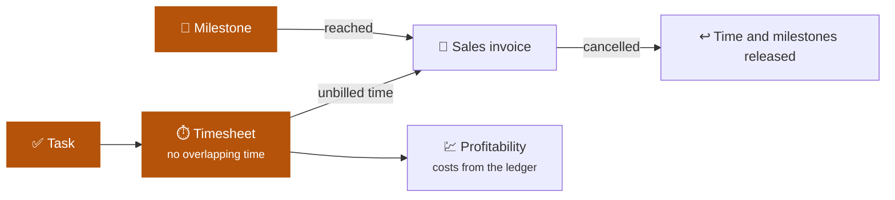
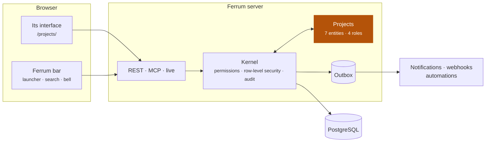
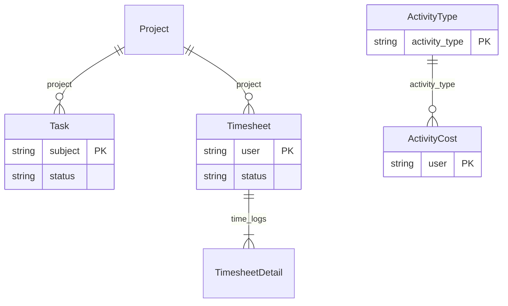

<div align="center">

<picture>
  <source media="(prefers-color-scheme: dark)" srcset="docs/assets/banner-dark.svg">
  
</picture>

[](https://github.com/CBFerrum/ferrum-app-projects/actions/workflows/ci.yml)      

**A native app for [Ferrum](https://github.com/CBFerrum/Ferrum), the open-source, AI-first business platform.**

[Overview](#overview) · [Highlights](#highlights) · [Screenshots](#screenshots) · [How it works](#how-it-works) · [Data model](#data-model) · [Install](#install) · [Develop](#develop) · [Changelog](#changelog)

</div>

---

## Overview

Ferrum Projects plans and bills work. Projects carry a billing method, a budget and progress;
tasks nest with cycle-safe dependencies and milestones; timesheets refuse overlapping time; and
unbilled time or milestones become invoices from the project, released again if the invoice is
cancelled. Profitability reads costs straight from the ledger.


| At a glance | |
|---|---|
| 📦 Version | `0.4.1` |
| 🧱 Platform | Ferrum `>=0.3.2, <0.4` |
| 🔗 Requires | nothing else |
| 🖥️ Interface | its own, at `/projects/` |
| 🗃️ Records | 7 entities in 2 packages |
| 👥 Roles | 4: Projects Manager, Projects User, Accounts Manager, Projects Manager |
| 📊 Reports | 3 |
| 🧪 Tests | 8 Rust tests, 1 interface test file |


## Highlights

<table>
<tr>
<td width="50%" valign="top">

### 🗂️ Projects that know how they bill
Time and materials, fixed price or non-billable, with budgets and progress.

</td>
<td width="50%" valign="top">

### 🌳 Task trees
Dependencies (cycle-safe), milestones and assignees.

</td>
</tr>
<tr>
<td width="50%" valign="top">

### ⏱️ Honest timesheets
Activity types and per-person costs; overlapping time is refused.

</td>
<td width="50%" valign="top">

### 🧾 Billing from the project
Invoice unbilled time or milestones; cancelling the invoice releases them.

</td>
</tr>
<tr>
<td width="50%" valign="top">

### 💹 Profitability
Project profitability with ledger costs, a timesheet summary and a task overview.

</td>
<td width="50%" valign="top">

### 🤝 A shared record
Projects are a platform record other apps link to: Helpdesk, Field Service and CRM.

</td>
</tr>
</table>

## Screenshots

<picture>
  <source media="(prefers-color-scheme: dark)" srcset="docs/assets/projects-dark.webp">
  
</picture>

<p align="center"><sub>Projects with their progress, customers and dates.</sub></p>

> [!TIP]
> The screenshots follow your GitHub theme: switch between light and dark to see both.

## How it works

### Time to invoice



### Inside Ferrum



Everything Projects adds is ordinary Ferrum metadata and Rust: its records get lists, forms,
search, permissions, an audit trail, exports and the REST and MCP APIs for free, so AI agents work
with them under the same rules as people.

### What it adds to Ferrum

| Where | What |
|---|---|
| 🚀 Launcher | **Projects** at `/projects/` |
| ➕ Create menu | Task |
| ➕ Create menu | Project |
| 🔔 Notification | Tasks assigned to you |
| ✅ My work | Your tasks |

## Data model

The main records and how they connect (7 entities in all; `packages/` has every field).



### Roles

| Role | What it is for | Entities |
|---|---|---|
| **Projects Manager** | Plans projects and tasks, sees costs, and bills customers for time and milestones. | 11 |
| **Projects User** | Records own time and works on the tasks assigned to them. | 6 |
| **Accounts Manager** |  | 5 |
| **Projects Manager** |  | 4 |

<details>
<summary><b>Reports (3)</b></summary>

- Project Profitability
- Timesheet Summary
- Task Overview

</details>

## Install

Workspace administrators install it from **Apps** (`/store/`) in Ferrum; it ships in the
official Ferrum server image. Self-hosters building their own image enable the
`projects` feature of the server. Everything it adds is also available to AI agents over
Ferrum's MCP server, within each person's permissions.

## Develop

Clone it next to the platform:

```text
work/
├── ferrum/            https://github.com/CBFerrum/Ferrum (with Ferrum-Frontend cloned into ferrum/web)
└── ferrum-app-projects/
```

Point the platform dependencies at your checkout (this file is git-ignored):

```toml
# .cargo/config.toml
[patch."https://github.com/CBFerrum/Ferrum"]
ferrum-apps = { path = "../ferrum/crates/apps" }
ferrum-domain = { path = "../ferrum/crates/domain" }
ferrum-kernel = { path = "../ferrum/crates/kernel" }
ferrum-meta = { path = "../ferrum/crates/meta" }
```

The tests need PostgreSQL with an ordinary (non-superuser) role, so row-level security
applies:

```bash
createuser ferrum --pwprompt && createdb -O ferrum ferrum_projects_test
cargo test
```

`FERRUM_PROJECTS_TEST_DATABASE_URL` overrides the database URL.


Its tests also build on [ferrum-app-erp](https://github.com/CBFerrum/ferrum-app-erp), which Cargo takes from GitHub.
To work on it alongside this app, clone it into the same folder and add to the same file:

```toml
[patch."https://github.com/CBFerrum/ferrum-app-erp"]
ferrum-app-erp = { path = "../ferrum-app-erp" }
```


The interface lives in `ui/` and builds with Ferrum-Frontend's packages:

```bash
cd ui
npm run build      # ui/dist, checked against the size budget
npm test
```

With a development server started with `FERRUM_DEV_UI=1`, `ferrum-app dev --ui` serves the pages
from Vite behind the real bar and session, with hot reload.


### Project layout

```text
app.yaml      the manifest: id, version, requirements, what it adds to Ferrum
packages/     metadata: entities, roles, reports, workflows, print formats
src/          the app's logic in Rust: hooks, actions, endpoints, upkeep jobs
ui/           its own interface (React + Vite), built into ui/dist
tests/        integration tests against a real PostgreSQL
CHANGELOG.md  what changed in each version
```

## Changelog

| Version | Highlights |
|---|---|
| **0.4.1** | The interface starts faster: its first download holds the frame and the app's own pages, and lists, forms, reports and other apps' screens load … |
| **0.4.0** | Home's My work lists your open tasks (`/api/app/projects/work`, Ferrum docs/plan/apps-ui.md §12.8), due on their expected end, High and Urgent … |
| **0.3.2** | Rebuilt with Ferrum-Frontend a8d4dda: under the platform's bar the records frame no longer shows a second bell (the bar has notifications). |
| **0.3.1** | Someone added to a task's assignees is notified (kind `projects.assigned`, "Tasks assigned to you"), in the bar and by email unless they chose … |

Every version is in [CHANGELOG.md](CHANGELOG.md).

## License

[AGPL-3.0-only](LICENSE), like the platform. Part of [Ferrum](https://github.com/CBFerrum/Ferrum) ·
[Report an issue](https://github.com/CBFerrum/ferrum-app-projects/issues)
